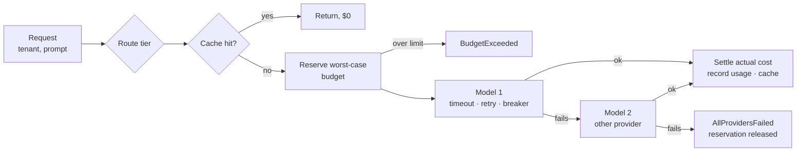

# llm-cost-reliability-guard

[](https://github.com/md-rubbaite/llm-cost-reliability-guard/actions/workflows/ci.yml)


**`LlmGuard` keeps LLM features inside budget and online: per-tenant spend limits, caching, cost-aware
model routing, retries, circuit breakers, provider fallback and cost reports, in one .NET gateway.**

## The problem

Once an LLM feature is in production, two things go wrong, often on the same day:

- **The bill.** Pricing is per token. A chatty tenant, an agent stuck in a loop or a giant prompt can
  spend a month's budget in an afternoon, and nobody knows until the invoice arrives.
- **The outage.** Providers rate-limit (429), time out and have regional incidents. Each service writes
  its own retry loop, the retries pile up, and users see errors instead of a slower or cheaper answer.

## What it does

| Concern | How LlmGuard handles it |
|---|---|
| Spend control | Per-tenant monthly budgets; the worst-case cost is **reserved before** the call, so concurrent requests cannot overspend; alert once at a threshold (default 80%) |
| Cost per request | Routes simple prompts to cheaper Small models and complex or long ones to Large models; explicit tier when the caller knows best |
| Repeated questions | Tenant-isolated exact-match cache with prompt normalisation, TTL and LRU limit; hits cost $0 |
| Rate limits and blips | Retries only transient errors, exponential backoff with full jitter, honours `Retry-After` |
| Provider outage | Circuit breaker per provider (closed → open → half-open with a single trial) and fallback to the next model of the same tier |
| Hangs | Per-attempt timeout, counted as a transient failure |
| Accountability | Actual cost from real token counts; usage records and a per-tenant, per-model Markdown cost report |

## Request flow



## Usage

```csharp
var gateway = new LlmGateway(
    providers: [azureOpenAi, anthropic],                  // your ILlmProvider adapters
    router: new ModelRouter(catalogInPreferenceOrder),     // models, tiers and prices
    budget: new BudgetLedger(new Dictionary<string, decimal> { ["retail"] = 500m, ["support"] = 200m }),
    cache: new ResponseCache(capacity: 10_000, ttl: TimeSpan.FromMinutes(30)),
    retry: new RetryPolicy(maxAttempts: 3),
    attemptTimeout: TimeSpan.FromSeconds(20));

var answer = await gateway.CompleteAsync(new LlmRequest("retail", "Where is my order 1042?"));
// answer.Model, answer.CostUsd, answer.FromCache, answer.Fallbacks …

Console.WriteLine(gateway.UsageReport());
```

An adapter implements one method and throws `TransientLlmException` (with `RetryAfter` when the provider
sends it) for 429, 5xx and timeouts; anything else is treated as non-retryable.

## Outage simulation

`samples/OutageDemo` sends traffic for two tenants while the primary provider first rate-limits and then
goes down. CI runs it and shows the output in the job summary:

```text
retail   Small primary   small-model    $0.000095  direct
retail   Small primary   small-model    $0.000000  cache
retail   Large primary   large-model    $0.001613  direct
…
retail   BLOCKED  Tenant 'retail' budget of $0.005 for 2026-11 would be exceeded (…)
retail   Small secondary small-model-b  $0.000189  fallback after 1 issue(s)
…
Breaker state for 'primary': Open
```

Prices in the sample are placeholders. Keep the real catalog in configuration and update it from each
provider's published price list.

## Design notes

- [ADR 0001](docs/adr/0001-one-gateway-for-llm-cost-and-reliability.md): why one gateway, the order of
  the steps, and the trade-offs.
- Token counts before the call are estimated (about four characters per token) only to size the budget
  reservation; the settled cost always uses the provider's reported tokens.
- The cache is in-memory per process; use a shared store for multiple instances. Semantic caching is not
  included on purpose: it needs embeddings and a similarity threshold validated for each use case.

## Tests

```bash
dotnet test tests/LlmGuard.Tests
```

34 tests: routing, exact cost arithmetic, retries with Retry-After, fallback on outage and on
non-retryable errors, timeouts, the circuit breaker's full cycle, budget reservation and release,
monthly reset, threshold alerts, 200 concurrent reservations that must not overspend, cache
normalisation, tenant isolation, expiry and LRU eviction, and the usage report. Time is injected, so
nothing sleeps.

---

Author: [Rubbaite T. Hassain](https://tanvir.info.bd) ([LinkedIn](https://www.linkedin.com/in/rubbaite)) · Software Architect, Founder of [Datazo InfoTech](https://www.datazoinfotech.com.bd) · MIT License
